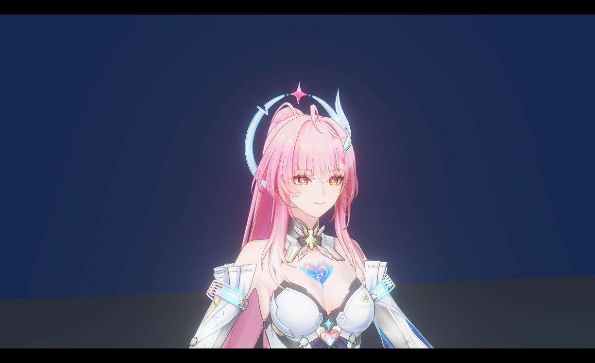
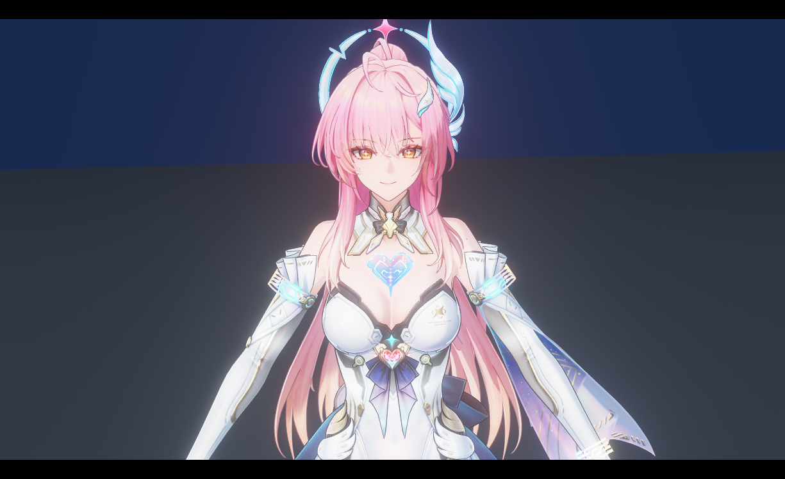
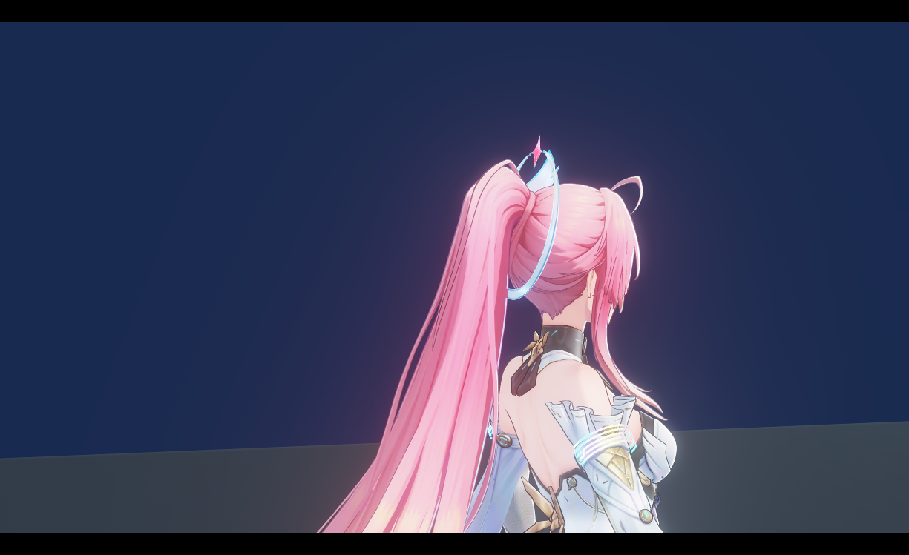
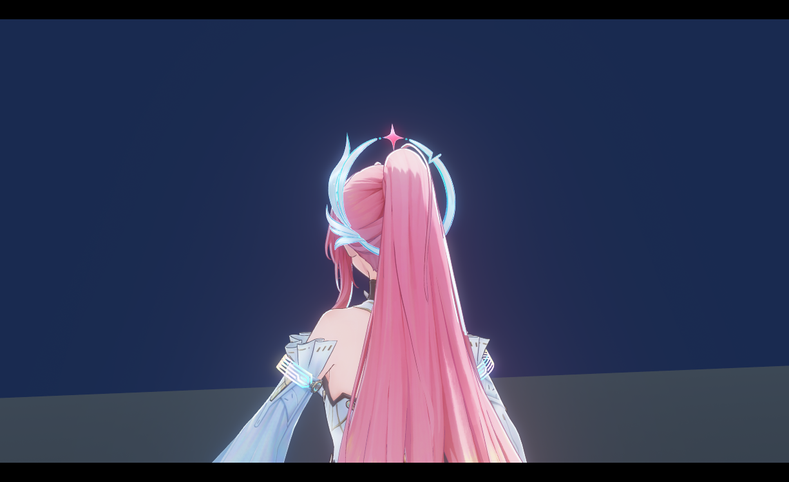

# 二次元角色卡通渲染（UE5）

用 UE5 前向管线复刻鸣潮风格的角色卡通渲染，样本角色为爱弥斯，模型与贴图均来自模之屋。核心思路是 **PBR 打底 + NPR 改造**：衣服与饰件保留完整 PBR 骨架，在每个光照阶段出口用 Ramp 贴图重映射；面部、头发、眼睛走 NPR 路径，配合自定义后期输出。

## 效果展示

24 秒实机运镜录屏，2560×1440 / 30 fps，三段直接切接：全身展示 → 头发与头环近景 → 背面转 3/4 侧。PIE 实机逐帧采集，原生分辨率输出，未做补帧或放大。

<video width="100%" controls muted playsinline poster="https://raw.githubusercontent.com/Aruvelut111/ue5-toon-rendering/master/videos/poster_showcase50.jpg" src="https://raw.githubusercontent.com/Aruvelut111/ue5-toon-rendering/master/videos/Aimisi_Showcase50.mp4"></video>

若内嵌播放器未出现，可直接<a href="videos/Aimisi_Showcase50.mp4">查看 / 下载原片（35 MB）</a>。

## 近景效果

正面头部细节（面部 SDF 阴影、虹膜高光、头环亮边）：

侧面 / 背面（发束分片、前发对脸的遮挡、后发分束明暗）：

## 方案总结

整体是**同一套光照框架，按材质分派两种计算路径**：

| 光照阶段 | PBR 类材质（衣服/饰件/皮肤） | NPR 类材质（脸/头发/眼睛） |
| --- | --- | --- |
| 直接光漫反射 | NdotL → Ramp 色阶采样 | SDF 面部阴影 / NdotL → Ramp |
| 环境漫反射 | 球谐采样 + 归一化 | 同左 |
| 直接光高光 | GGX → Ramp 调制 | 高光贴图 / MatCap |
| 环境高光 | Ramp 菲涅尔（背光侧增强） | 同左 |

Ramp 贴图是整个管线的核心控制手段：色阶过渡直接画在贴图行里，着色器只负责把光照量映射到 UV，改色不用碰代码。

## 实现要点

### 衣服与皮肤

保留完整 PBR 骨架（F0、GGX NDF、Smith G、Schlick F），每个阶段出口用 Ramp 重映射。皮肤按部位拆分 SSS 输入（面/颈/臂等），用厚度贴图近似次表面散射的暖色渗透。

### 面部

- **SDF 阴影**：一张 SDF 贴图按光照方向做阈值比较，得到亮/暗面软过渡，比单纯 NdotL 更接近赛璐珞硬边阴影；
- **局部高光**：SDF 其他通道标记鼻尖、唇角等位置，配合光照方向做高光掩码；
- **虹膜**：视角相关的 UV 视差偏移 + 双层叠加（底层眼球 + 上层高光/压暗）。

### 头发

前发与后发分开处理，共用一套光照。高光使用随模型附带的分布贴图，采样 UV 随视角方向做切向偏移，模拟发丝高光随头转动的流动感；前发对面部/眉毛/眼睛的遮挡与半透用**模板缓冲多 Pass** 实现，投影位置跟随主光方向偏移。

### 描边

法线外扩方案，顶点色预存平滑法线解决硬边截断；外扩在裁剪空间进行并做宽高比矫正与透视补偿（预乘 clip.w）。背面观察时描边随光照方向做明暗面区分。

### 后期

画面最终经自定义 Pass 做色彩分级与色调映射，叠加 Bloom 合成输出。
